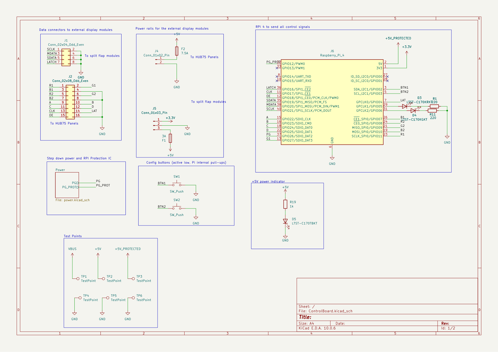
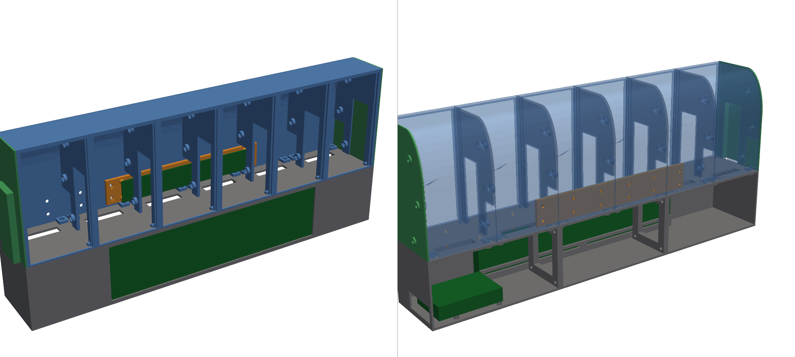

# SplitFlap Display Control Board

A Raspberry Pi 4 controller board for a split-flap display with HUB75 LED matrix panels. One USB-C PD cable powers the Pi, the split-flap motor drivers and the LED panels.

## Features
- **USB-C PD input:** an Adafruit HUSB238 breakout asks the charger for 20 V / 3 A (60 W)
- **12–20 V → 5 V buck converter:** TI TPS56A37, up to ~8 A. An EN/UVLO divider keeps it off until PD has negotiated, and its power-good goes to a Pi GPIO.
- **Pi protection:** a TPS259474 eFuse on the Pi's 5 V rail (5.83 V overvoltage cutoff, 3.5 A current limit, power-good to a GPIO)
- **Fused outputs:** 7.5 A for the HUB75 panels and 3 A for the split-flap modules (ATO blade fuses)
- **TVS protection:** SMAJ22A on VBUS and SMAJ6.0A on 5 V
- **Connectors:** HUB75 data header, split-flap (Chainlink) data bus, two config buttons and status LEDs

## Repo layout
| Path | Contents |
|---|---|
| `control board/ControlBoard/` | KiCad 10 project (schematic, PCB, custom symbols/footprints) |
| `control board/ControlBoard/fab/` | JLCPCB gerbers, assembly files, DigiKey BOM |
| `housing/` | Enclosure: CadQuery scripts, STEP and STL files |
| `pi/` | Raspberry Pi smoke test for the Chainlink driver |
| `hub_75_test/` | HUB75 LED panel test firmware (Arduino + ESP-IDF) |
| `docs/` | Schematic PDF and renders |

## Schematics

## PCB
| Top | Bottom |
|:---:|:---:|
|  |  |

## Enclosure

The split-flap mechanism and driver boards come from [scottbez1/splitflap](https://github.com/scottbez1/splitflap). This repo contains only the control board and enclosure I designed for it.
